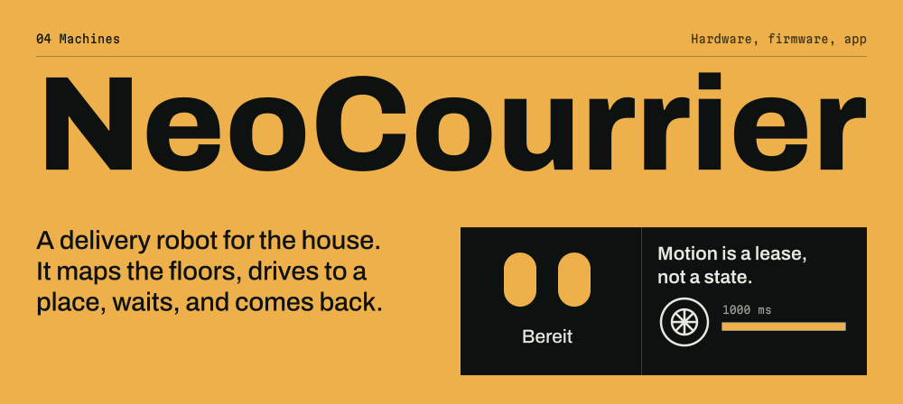

I'm Neo, founder of [NeoLabs](https://github.com/NeoLabs-Systems) in Germany. Most of my work starts the same way: something should exist, it doesn't, so I build it. Schematic to PCB, firmware to backend, API to interface.

**[neo.eu.com](https://neo.eu.com)** · [contact@neo.eu.com](mailto:contact@neo.eu.com) · [Discord](https://discord.gg/f59rg2RwUT)

&nbsp;

Its own computer, a memory, a schedule and a voice, on your hardware, with the model you choose. 42 triggers, 24 chat channels, and it asks before anything risky.

[Project site](https://neolabs-systems.github.io/NeoAgent/) · [Source](https://github.com/NeoLabs-Systems/NeoAgent) · 

&nbsp;

Connect free tiers, paid APIs and your own servers. 80+ providers behind one OpenAI and Anthropic compatible endpoint, with an auto router that learns as it goes.

[Project site](https://neolabs-systems.github.io/NeoRouter/) · [Source](https://github.com/NeoLabs-Systems/NeoRouter) · 

&nbsp;

A self-hosted audio memory for web, desktop and wearable clients. It tells speakers apart on your machine, and silence is never sent anywhere.

[Project site](https://neolabs-systems.github.io/NeoRecall/) · [Source](https://github.com/NeoLabs-Systems/NeoRecall) · 

&nbsp;

Two hub motors, an ESP32 for everything with a safety requirement, a Raspberry Pi 5 with LiDAR for the rest, and a LoRa radio. A drive command only lasts 1000 ms, so anything that breaks stops the wheels. It also asks people to open doors. Private repo for now.

&nbsp;

A one-layer PCB, a mission dashboard, and a guided flow from connect to countdown, with live weather and aircraft checks.

[Launch System](https://github.com/NeoLabs-Rockets/Launch-System) · [NL-1 Pioneer](https://github.com/NeoLabs-Rockets/NL-1-Pioneer) · [Launch Platform](https://github.com/NeoLabs-Rockets/Launch-Platform)

&nbsp;

## Elsewhere

| Project | What it is | Stars |
| :--- | :--- | ---: |
| [Omi](https://github.com/BasedHardware/omi) | Open-source AI wearable. 109 commits across firmware, backend and apps | 13.9k |
| [HowCloseToWorldEnd](https://github.com/neooriginal/HowCloseToWorldEnd) | An LLM reads the news and scores how close we are to the edge | 61 |
| [OMI.me Apps](https://github.com/neooriginal/OMI.me-Apps) | Apps for the Omi wearable, forked nine times | 32 |
| [Operon.one](https://github.com/neooriginal/Operon.one) | An early multi-tool agent that acts across platforms | 18 |
| [AHDA](https://github.com/neooriginal/AHDA) | Actually Helpful Digital Assistant. Lets an LLM control your PC | 12 |
| [ASAR](https://github.com/neooriginal/ASAR) | Actually Smart AI Radio, on air on Discord around the clock | 10 |
| [Aether](https://github.com/neooriginal/Aether) | Your knowledge as a navigable 3D graph, self-hosted | 5 |
| [ARCS](https://github.com/neooriginal/ARCS) | Robot control: AI agent, VR arm teleoperation, active safety | 4 |
| [BetterOMIApp](https://github.com/neooriginal/BetterOMIApp) | An alternative app for the Omi wearable | 4 |
| [NeoNutri](https://github.com/NeoLabs-Systems/NeoNutri) | Photograph a meal, get the macros. Runs on your server | 1 |
| [WorldEndArchive](https://github.com/neooriginal/WorldEndArchive) | A crawler and offline reader. A digital Noah's Ark for knowledge | |
| [llm-guardian](https://github.com/neooriginal/llm-guardian) | Safety research: an AI shall not allow a human to come to harm | |
| [RabbitR1 Hack](https://github.com/neooriginal/RabbitR1-OpenClaw-Hack) | Reverse-engineered the link between a Rabbit R1 and OpenClaw | |

[All repositories](https://github.com/neooriginal?tab=repositories) · [NeoLabs Systems](https://github.com/NeoLabs-Systems) · [NeoLabs Rockets](https://github.com/NeoLabs-Rockets)
